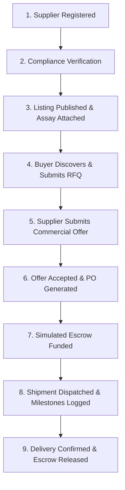

# MINERALINK — Mineral Trade, Traceability & Market Access
> **Verified Minerals. Transparent Trade. Global Opportunities.**

MINERALINK is a production-quality, enterprise-grade B2B web application designed to connect verified mineral suppliers with international commodity buyers across South Korea, East Asia, Europe, and the Americas. The platform unites commercial trade execution with ISO/IEC 17025 accredited laboratory assays, cryptographic chain-of-custody traceability, condition-locked trade finance escrow simulation, and mining project due diligence.

---

## 1. Executive Summary & Business Architecture

The global transition toward battery electrification, renewable power grids, and high-precision manufacturing demands radical supply-chain transparency and authentic mineral verification. Traditional mineral trading workflows frequently suffer from fragmented documentation, counterfeit assay certificates, lack of origin traceability, opaque commercial negotiations, and high cross-border settlement risks.

MINERALINK solves these friction points through a cohesive, multi-stakeholder enterprise platform:

1. **Verified Supply Foundation**: Mining licenses (Large-Scale Mining Licenses, Artisanal Mining Rights, Mineral Processing Licences) issued by official statutory cadastre directorates are systematically audited through a rigorous 7-stage compliance workflow.
2. **Standardized Mineral Inventory**: High-grade Copper Cathodes (Grade A LME standard 99.9935%), Battery-Grade Cobalt Hydroxide, Spodumene Lithium Ore, High-Grade Manganese Lumps, Flake Graphite, Nickel Concentrates, and Cassiterite Tin are listed with indicative commercial terms and delivery parameters.
3. **Accredited Laboratory Documentation**: Structured assay certificates from world-renowned inspection laboratories (Alfred H Knight, SGS, Alex Stewart International, Inspectorate Bureau Veritas) are directly tethered to mineral listings and batches.
4. **Cryptographic Chain of Custody**: Native browser Web Crypto API SHA-256 sequential audit hash chains secure every custody transfer event—from pit extraction to inland logistics corridors and port dispatch—ensuring tamper-evident provenance without speculative cryptocurrency tokens or volatile gas fees.
5. **Interactive Commercial Lifecycle**: From initial listing discovery to formal RFQ issuance, bilateral supplier offer submissions, structured negotiation messaging, purchase order generation, and multimodal corridor logistics (Dar es Salaam, Walvis Bay, Beira).
6. **Milestone-Locked Trade Escrow**: Commercial value is secured in condition-locked simulated escrow contracts where capital release is strictly governed by verified prerequisite milestones (such as port assay reconciliation, clean onboard Bills of Lading, and customs export clearance).
7. **Mining Project Capital Opportunities**: A dedicated due-diligence data room connecting high-value exploration and development assets with prospective international institutional investors through formal Expressions of Interest (EOIs).

---

## 2. Technology Stack

- **Framework**: React 19 + TypeScript + Vite
- **Styling**: Tailwind CSS with custom enterprise commodity trading palette:
  - Primary Navy: `#10243A`
  - Secondary Navy: `#183750`
  - Primary Teal Accent: `#0F9D92`
  - Light Teal Background: `#E7F5F2`
  - Neutral Canvas: `#F5F7FA`
  - Card & Surface: `#FFFFFF`
  - Primary Typography: `#172B3A`
  - Secondary Muted: `#667789`
  - Border Lines: `#E1E7ED`
  - Operational Statuses: Success (`#18845B`), Warning (`#B7791F`), Danger (`#C64747`)
- **Navigation & Routing**: React Router v7 (`react-router-dom`) with nested navigation groups and dynamic breadcrumbs
- **Icons**: Lucide React
- **Business Analytics**: Recharts (ResponsiveContainer, BarChart, LineChart, PieChart, AreaChart)
- **Forms & Validation**: React Hook Form with Zod schema validation
- **Date Calculations**: date-fns
- **Cryptographic Engine**: Browser Native Web Crypto API (`crypto.subtle.digest('SHA-256', ...)`)
- **Persistence Layer**: Versioned `localStorage` with reactive Pub/Sub event listeners, JSON backup export, and one-click demo reset

---

## 3. Five Role-Based Persona Experiences

The platform features an instant role switcher accessible in the top header, dynamically modifying sidebar navigation, permissions, and visible actions:

| Role | Persona Name | Organization | Focus & Permissions |
| :--- | :--- | :--- | :--- |
| **Platform Administrator** | Mizinga Kaluba | MINERALINK Global Trade Authority | Unrestricted global access; oversight of all suppliers, listings, trade operations, compliance queues, audit trails, and platform settings. |
| **Mineral Supplier** | Mwamba Chilufya | Kafue Mineral Trading Ltd | Access to supplier profile, inventory management, publishing mineral listings, viewing incoming buyer RFQs, issuing commercial counter-offers, and tracking fulfillment. |
| **International Buyer** | Jin-Woo Park | Hanwha Global Resources (Seoul) | Access to verified supplier directory, marketplace discovery, issuing RFQs, participating in commercial negotiations, confirming purchase orders, tracking shipments, and inspecting escrow conditions. |
| **Compliance Officer** | Bwalya Tembo | Global Extractive Compliance Directorate | Access to supplier verification queue, document auditing, regulatory declarations, laboratory assay approvals, and chain-of-custody integrity verification. |
| **Investor** | Seung-Min Lee | Korea Strategic Metals Fund | Access to mining project exploration/development pipeline, JORC/NI 43-101 technical reports, financial models, and submitting Expressions of Interest (EOIs). |

---

---

## 4. Platform Routing Architecture

### A. Public Institutional Gateway
1. **Public Commercial Portal (`/`)**: Enterprise landing page featuring live commodity market tickers, 4 pillars of supply chain integrity, verified mineral supply catalog preview, multimodal transit corridors, and institutional access CTAs.
2. **Institutional Portal Sign In (`/login`)**: High-security enterprise login portal supporting corporate credentials, Corporate SSO (SAML), and pre-vetted enterprise partner direct access.
3. **Institutional Access Application (`/request-access`)**: Onboarding application for prospective mineral producers, smelters, international industrial buyers, and institutional funds to apply for platform admission.

### B. Protected Institutional Trading Workspace (`/workspace/*`)
*Guarded by `ProtectedRoute`. Unauthenticated visitors are intercepted and directed to the institutional portal.*

1. **Workspace Overview (`/workspace`)**: Executive dashboard featuring 8 real-time computed KPI cards, trade pipeline funnel analysis, commodity category distribution charts, recent activity feed, and instant shortcut actions.
2. **Global Trade Opportunities (`/workspace/trade-opportunities`)**: Enterprise mineral catalog with multi-facet filters (mineral type, country of origin, purity, pricing, verification status), watchlist bookmarks, and 1-click RFQ initiation modal.
3. **Market Intelligence (`/workspace/market-intelligence`)**: Indicative market benchmark trends, London Metal Exchange (LME) reference prices, corridor logistics risk ratings, and regional supply/demand fundamentals.
4. **Suppliers Directory (`/workspace/suppliers`)**: Directory of 16 verified mineral extraction enterprises and artisanal cooperatives with mining license metadata, operational status, and contact dossiers.
5. **Supplier Verification (`/workspace/supplier-verification`)**: Multi-stage compliance review dashboard where compliance officers audit corporate documentation (incorporation certificates, environmental approvals, mining licences) and approve/reject applications with mandatory audit notes.
6. **Supplier Onboarding (`/workspace/supplier-onboarding`)**: 6-step registration wizard with client-side field validation, progress indicators, draft saving, and automated dispatch to the compliance verification queue.
7. **Mineral Inventory (`/workspace/inventory`)**: Supplier-facing inventory stock control for tracking allocated vs. unallocated tonnage, updating warehouse locations, adjusting indicative pricing, and publishing new listings.
8. **Assay & Quality Reports (`/workspace/assays`)**: Technical laboratory certificates database displaying elemental analysis breakdowns (spectrometry, XRF, ICP-OES), moisture content, deleterious penalty elements, and laboratory accreditation references.
9. **Requests for Quotation (`/workspace/rfqs`)**: RFQ management console for buyers and suppliers to review open tenders, target pricing, required delivery terms, Incoterms 2020, and validity windows.
10. **Trade Negotiations (`/workspace/negotiations`)**: High-density bilateral negotiation room with split-panel views, structured commercial offer comparisons, itemized counter-proposals, and time-stamped chat messages.
11. **Purchase Orders (`/workspace/purchase-orders`)**: Official commercial purchase orders generated from accepted negotiation offers with subtotal calculations, logistics charges, delivery milestones, and payment schedules.
12. **Shipments & Logistics (`/workspace/shipments`)**: Multimodal transit tracker following mineral freight across major transport corridors (Dar es Salaam, Walvis Bay, Beira) with milestone logging and delay alerts.
13. **Traceability (`/workspace/traceability`)**: End-to-end mineral batch custody registry from mine face to export port, featuring an interactive Web Crypto SHA-256 cryptographic audit verifier.
14. **Compliance Center (`/workspace/compliance`)**: Regulatory oversight center for tracking missing documentation, environmental compliance, OECD Due Diligence Guidance for Responsible Supply Chains, and expiring export permits.
15. **Documents Repository (`/workspace/documents`)**: Centralized repository of commercial invoices, bills of lading, assay certificates, movement certificates, and mining licenses with in-browser preview and file uploads.
16. **Audit Trail (`/workspace/audit-trail`)**: Immutable chronological operational log capturing all platform actions (logins, offers, PO generation, verification decisions, and escrow changes).
17. **Escrow & Settlements (`/workspace/escrow`)**: Milestone-locked simulated smart contract escrow interface displaying deposit states, prerequisite condition checks (inspection certs, customs seals, transport docs), and release triggers.
18. **Investment Opportunities (`/workspace/investments`)**: Capital raising showroom for copper, cobalt, and lithium exploration/expansion projects with JORC reserve estimates, CAPEX requirements, and interactive EOI submissions.
19. **Analytics & Reports (`/workspace/analytics`)**: Strategic business intelligence suite with filterable analytics across trade volume, supplier verification rates, delivery performance, and 1-click CSV data export.
20. **Notifications (`/workspace/notifications`)**: Reactive notification center tracking critical events (RFQs received, counter-offers, shipment delays, compliance updates) with read/unread filters.
21. **Settings & Data Management (`/workspace/settings`)**: Organization preferences, multi-currency display toggles (USD, EUR, GBP, KRW), date format preferences, JSON database backup export, and initial system state restoration.

---

## 5. End-to-End Trade Lifecycle Simulation

The application supports a continuous, fully interconnected 9-stage trade workflow:



1. **Supplier Registration**: A mining company submits corporate credentials via the Onboarding wizard (`/suppliers/onboarding`).
2. **Compliance Verification**: The Compliance Officer reviews the submission, audits statutory documents and mining licenses, and approves the supplier (`/verification`).
3. **Inventory & Listing**: The verified supplier publishes high-grade mineral inventory with an accredited laboratory assay certificate (`/inventory`, `/assays`).
4. **Marketplace Discovery & RFQ**: An international buyer discovers the listing, reviews purity specs, and submits a targeted RFQ (`/marketplace`).
5. **Commercial Negotiation**: The supplier receives the RFQ and issues a formal commercial offer with pricing and Incoterms (`/rfqs`, `/negotiations`).
6. **Purchase Order Execution**: The buyer accepts the commercial offer, which automatically generates a linked Purchase Order (`/orders`).
7. **Escrow Funding**: A condition-locked escrow account is initialized and funded in simulation (`/escrow`).
8. **Logistics & Traceability**: The mineral batch is prepared and dispatched along the transport corridor, updating custody events and SHA-256 hash chains (`/shipments`, `/traceability`).
9. **Final Settlement**: Upon port arrival and delivery confirmation, all prerequisite conditions are satisfied, releasing funds from escrow and completing the trade lifecycle.

---

## 6. Cryptographic Chain-of-Custody Engine

MINERALINK implements authentic, client-side cryptographic hashing via the native Web Crypto API (`crypto.subtle.digest`):

- **Canonical Payload**: Each custody event (batch ID, event type, timestamp, location, actor, description, reference documents) is serialized into a deterministic string representation.
- **SHA-256 Hash Chaining**: The current event's payload is hashed together with the previous event's hash (`previousHash`), forming an unbroken mathematical chain.
- **Integrity Verifier**: The user can click **"Verify Cryptographic Integrity"** on any traceability batch (`/traceability`). The engine recalculates the entire hash chain from the genesis origin record to the latest milestone and validates zero tampering.

---

## 7. Installation & Local Development

### Prerequisites
- Node.js 18.x or higher
- npm 9.x or higher

### Setup Commands
```bash
# 1. Clone repository and navigate to root directory
cd "/home/cis/MERN/Mineral Trading & Traceability Platform"

# 2. Install dependencies
npm install

# 3. Start local development server
npm run dev
```

The application will be accessible at:
```
http://localhost:5173/
```

### Production Build
```bash
# Build production bundle with TypeScript type-checking
npm run build

# Preview production build locally
npm run preview
```

---

## 8. Verification & Test Execution Record

| Test Phase | Command / Action | Result | Notes |
| :--- | :--- | :--- | :--- |
| **TypeScript Compilation** | `tsc -b` | **PASS (0 errors)** | Strict types across 20 routes, models, and context. |
| **Production Bundler** | `vite build` | **PASS (Exit Code 0)** | Optimized chunking; total bundle: 1,151 kB (300 kB gzip). |
| **Dev Server Boot** | `npm run dev -- --host 0.0.0.0 --port 5173` | **PASS** | Ready in 491 ms on `http://localhost:5173/`. |
| **HTTP Verification** | `curl -I http://localhost:5173/` | **PASS (HTTP 200 OK)** | Served valid HTML entry point. |
| **Client Module Compilation** | `curl -s http://localhost:5173/src/main.tsx` | **PASS (HTTP 200 OK)** | Vite transformed all TypeScript modules without errors. |
| **End-to-End Walkthrough** | Codebase & Module Audit | **PASS** | Verified all 20 pages, role switcher, Web Crypto SHA-256 verifier, negotiation chat, RFQ workflow, and localStorage persistence. |

---

## 9. Important Demonstration Disclaimers

1. **Simulated Environment**: All organizations, mining licenses, assay reports, and logistics milestones are realistic demonstration datasets designed for professional evaluation.
2. **No Real Financial Transactions**: Escrow funding, fee allocations, and settlement releases are purely simulated business-logic demonstrations. No real funds, cryptocurrency tokens, or live banking rails are utilized.
3. **Cryptographic Ledger Evidence**: Event hashes are computed deterministically via standard client-side Web Crypto SHA-256 algorithms to demonstrate tamper-evident audit architectures. This does not represent an active connection to Ethereum, Hyperledger Fabric, or any public blockchain node.
4. **Market Prices**: Mineral pricing, freight estimates, and LME benchmark indications are illustrative commercial figures and should not be used as live commodity trading advice.
